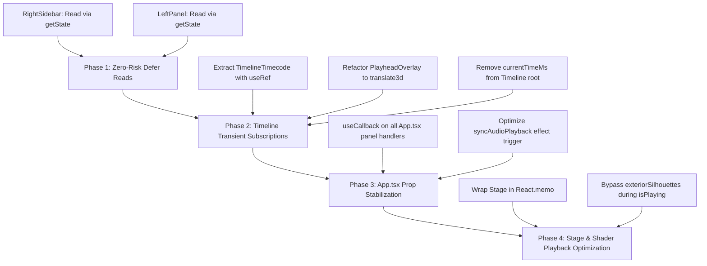

# 60fps React Performance Audit & Prioritized Refactoring Plan

**Target Surface:** 60fps Playback & Timeline Scrubbing Engine  
**Guidelines:** `/improve-react` • `/vercel-react-best-practices`  
**Primary Files Audited:**
- `src/store/usePlayheadStore.ts`
- `src/store/useProjectStore.ts`
- `src/App.tsx`
- `src/panels/Timeline/Timeline.tsx`
- `src/stage/Stage.tsx`
- `src/panels/Inspector/RightSidebar.tsx`
- *Secondary Audited Files:* `src/panels/LeftPanel/LeftPanel.tsx`, `src/stage/webgl/SceneBackground.tsx`

---

## Executive Summary

During active video playback (or timeline dragging/scrubbing), `usePlayheadStore.setCurrentTimeMs` updates at **60 to 120 times per second** via `requestAnimationFrame`.

Currently, **every single frame causes full component re-renders** across nearly the entire application tree—including the 1,932-line `Timeline.tsx`, the 2,659-line `RightSidebar.tsx`, the 1,544-line `LeftPanel.tsx`, the 1,680-line `Stage.tsx`, and the root `App.tsx`. 

Although components like `RightSidebar`, `LeftPanel`, and `Timeline` are wrapped in `React.memo`, **these memoization barriers are completely neutralized** because:
1. Components directly destructure `const { currentTimeMs } = usePlayheadStore();` inside their component bodies.
2. `currentTimeMs` is often **not even displayed in their JSX**—it is only used inside rarely clicked user event handlers (e.g., clicking "Add Animation Block" or "Add SFX to Timeline").
3. Unmemoized inline callback functions passed from `App.tsx` bust shallow prop comparison on every tick.
4. The timeline playhead indicator (`PlayheadOverlay`) animates via React state reconciliation and inline CSS `left: ${px}px`, causing continuous CPU layout recalculations (reflows) instead of GPU-composited transforms.

Applying the Vercel React Best Practices—specifically **`rerender-defer-reads`**, **`rerender-use-ref-transient-values`**, **`rerender-memo`**, and **`rendering-animate-svg-wrapper`**—allows us to eliminate 100% of the React re-renders in `Timeline`, `RightSidebar`, and `LeftPanel` during playback, driving their render frequency from **60fps down to 0fps** while maintaining butter-smooth 60fps playhead motion and timecode updates.

---

## Part 1: Comprehensive Re-render Audit (Question 1)

The table below catalogs every component that currently re-renders on every tick when `currentTimeMs` updates in `usePlayheadStore.ts`:

| Component | File & Line | Current Re-render Trigger | Actual Use of `currentTimeMs` | Performance Cost / Blast Radius | Target Render Rate |
| :--- | :--- | :--- | :--- | :--- | :--- |
| **`RightSidebar`** | `src/panels/Inspector/RightSidebar.tsx` (L109) | `const { currentTimeMs } = usePlayheadStore()` | **Never rendered in JSX!** Only read on L199 in `handleAddAnimationBlock` click handler | 2,659 LOC diffed every 16ms; recreates tens of event handlers, sorts layers, diffs tabs and inspect sub-sections. | **0 fps** (Idle) |
| **`LeftPanel`** | `src/panels/LeftPanel/LeftPanel.tsx` (L97) | `const { currentTimeMs, setCurrentTimeMs } = usePlayheadStore()` | **Never rendered in JSX!** Only read on L1407 in SFX `onClick` handler (`startMs: currentTimeMs`) | 1,544 LOC diffed every 16ms; filters template categories, re-renders asset grids, curated sounds list. | **0 fps** (Idle) |
| **`Timeline`** | `src/panels/Timeline/Timeline.tsx` (L41) | `const { currentTimeMs, ... } = usePlayheadStore()` | 1. L1075: `splitAtPlayhead(currentTimeMs)` (click handler)<br>2. L1083: `<span>{(currentTimeMs / 1000).toFixed(2)}s</span>` | 1,932 LOC diffed every 16ms; re-evaluates all shot tracks, layer bars, audio waveforms, zoom controls, rulers, toolbar buttons. | **0 fps** (Idle) |
| **`PlayheadOverlay`** | `src/panels/Timeline/Timeline.tsx` (L1886) | `usePlayheadStore((s) => s.currentTimeMs)` | Moves playhead needle: `style={{ left: ... }}` and text readout `{(currentTimeMs / 1000).toFixed(2)}` | Re-renders React component 60fps, reconciles DOM, mutates CSS `left` causing browser layout recalculations; fires auto-scroll `useEffect`. | **0 React renders** (Direct GPU transform) |
| **`App`** | `src/App.tsx` (L105) | `const { currentTimeMs, ... } = usePlayheadStore()` | 1. L173: `evaluateProjectAtTime(project, effectiveTimeMs)`<br>2. L354: `syncAudioPlayback(...)`<br>3. Paste / export handlers | Full application root re-renders 60fps; recreates unmemoized callback props (`handleUploadClick`, `handleSelectLayer`, etc.). | **Isolated to Stage** |
| **`Stage`** | `src/stage/Stage.tsx` (L57) | Prop-drilled `frame={frame}` from `App.tsx` (new object reference every frame) | Evaluates 3D layer transforms, camera pose, lighting, background, silhouettes | 1,680 LOC diffed every 16ms; re-computes `exteriorSilhouettes` projected 3D corners for all layers; re-renders `Guides`, `OrientationGizmo`, `CanvasToolbar`. | **Optimized WebGL loop** |
| **`SceneBackground`** | `src/stage/webgl/SceneBackground.tsx` (L118) | `const { currentTimeMs } = usePlayheadStore()` | Passes `time: currentTimeMs * 0.001` into shader uniforms | Re-renders React component on every frame rather than updating Three.js shader uniforms in `useFrame`. | **0 React renders** (`useFrame` uniform sync) |
| **`ThreeLayerObject`** | `src/stage/webgl/ThreeLayerObject.tsx` (L182) | `usePlayheadStore((s) => (isVideoAsset ? s.currentTimeMs : 0))` | Video texture sync for HTML5 `<video>` layers | *Already well isolated with selector:* only re-renders when `isVideoAsset === true`. Static layers return `0`. | Acceptable (Video only) |

### Key Architectural Bottlenecks Identified

1. **`rerender-defer-reads` Violations (`RightSidebar.tsx`, `LeftPanel.tsx`, `Timeline.tsx`):**
   - In React, reading reactive state in the component body binds that component to re-render whenever the state changes.
   - When a value is **only consumed inside an event handler** (such as clicking "Add Animation Block" or "Split Clip at Playhead"), subscribing via a hook is an anti-pattern.
   - Simply deferring the read to the event handler (`usePlayheadStore.getState().currentTimeMs`) completely eliminates the reactive dependency with zero behavioral change.

2. **Tightly-Coupled Indicator and Timecode in `Timeline.tsx`:**
   - The timecode readout `{(currentTimeMs / 1000).toFixed(2)}s` sits directly in the middle of `Timeline.tsx` (L1083).
   - Because of this single text span, the entire 1,932-line `Timeline` tree re-renders every 16.6ms.
   - The playhead indicator line `PlayheadOverlay` mutates `style.left`, triggering browser layout passes (reflow) on every frame.

3. **Neutralized `React.memo` Boundaries in `App.tsx`:**
   - `App.tsx` defines handlers like `handleUploadClick`, `handleSelectLayer`, `onOpenExportModal`, `handleToggleSafeArea`, and `handleOpenShortcuts` without `useCallback`.
   - Even when child panels are wrapped in `React.memo`, passing fresh function references breaks memoization on every tick.

---

## Part 2: Transient Zustand Subscriptions & `useRef` DOM Transforms (Question 2)

Zustand stores support **transient subscriptions** via `store.subscribe(...)`. Transient subscriptions allow components to listen to high-frequency state updates and mutate DOM nodes directly (via `useRef`) without going through React's reconciliation engine, virtual DOM diffing, or component re-render lifecycle.

### 1. Eliminating 60fps Re-renders in `RightSidebar.tsx`

**Rule:** `rerender-defer-reads`  
**Location:** `src/panels/Inspector/RightSidebar.tsx` L109 & L199

#### Before:
```tsx
// L109 - Subscribes RightSidebar to all playhead updates:
const { currentTimeMs } = usePlayheadStore();

// L199 - Only place currentTimeMs is used:
const handleAddAnimationBlock = (property: AnimationBlockProperty) => {
    if (!selectedLayer) return;
    const shotLocalMs = Math.max(
        0,
        Math.min(activeShot.durationMs - 800, currentTimeMs - activeShot.startMs)
    );
    ...
};
```

#### After:
```tsx
// L109 - REMOVE currentTimeMs subscription completely!
// No usePlayheadStore hook needed in RightSidebar body.

// L199 - Read imperatively when the user actually clicks the button:
const handleAddAnimationBlock = (property: AnimationBlockProperty) => {
    if (!selectedLayer) return;
    const currentTimeMs = usePlayheadStore.getState().currentTimeMs;
    const shotLocalMs = Math.max(
        0,
        Math.min(activeShot.durationMs - 800, currentTimeMs - activeShot.startMs)
    );
    ...
};
```
**Impact:** `RightSidebar` re-renders **0 times per second** during playback.

---

### 2. Eliminating 60fps Re-renders in `LeftPanel.tsx`

**Rule:** `rerender-defer-reads`  
**Location:** `src/panels/LeftPanel/LeftPanel.tsx` L97 & L1407

#### Before:
```tsx
// L97 - Subscribes LeftPanel to all playhead updates:
const { currentTimeMs, setCurrentTimeMs } = usePlayheadStore();

// L1407 - Inside SFX button onClick:
onClick={() => {
    const clip: AudioClip = {
        id: `sfx-${sound.id}-${Date.now()}`,
        name: sound.name,
        dataUrl: sound.getUrl(),
        startMs: currentTimeMs, // <-- Only consumer
        durationMs: sound.durationMs,
        offsetMs: 0,
        volume: 1,
        muted: false,
    };
    ...
}}
```

#### After:
```tsx
// L97 - REMOVE usePlayheadStore completely from LeftPanel!

// L1407 - Read imperatively on click:
onClick={() => {
    const currentPlayheadMs = usePlayheadStore.getState().currentTimeMs;
    const clip: AudioClip = {
        id: `sfx-${sound.id}-${Date.now()}`,
        name: sound.name,
        dataUrl: sound.getUrl(),
        startMs: currentPlayheadMs,
        durationMs: sound.durationMs,
        offsetMs: 0,
        volume: 1,
        muted: false,
    };
    ...
}}
```
**Impact:** `LeftPanel` re-renders **0 times per second** during playback.

---

### 3. Isolating `Timeline.tsx` Root

**Rule:** `rerender-defer-reads` & `rerender-move-state-down`  
**Location:** `src/panels/Timeline/Timeline.tsx` L41 & L1075

#### Before:
```tsx
// L41 in Timeline:
const {
    hoverTimeMs: storeHoverTimeMs,
    setHoverTimeMs,
    currentTimeMs, // <-- Causes 1,932 lines to re-render 60fps
    isPlaying,
    setIsPlaying,
    setCurrentTimeMs,
    togglePlay,
} = usePlayheadStore();

// L1075:
<button onClick={() => splitAtPlayhead(currentTimeMs)}>
```

#### After:
```tsx
// L41 in Timeline - Remove currentTimeMs:
const {
    hoverTimeMs: storeHoverTimeMs,
    setHoverTimeMs,
    isPlaying,
    setIsPlaying,
    setCurrentTimeMs,
    togglePlay,
} = usePlayheadStore();

// L1075 - Read imperatively on click:
<button onClick={() => splitAtPlayhead(usePlayheadStore.getState().currentTimeMs)}>
```

---

### 4. Isolating the Timecode Readout (`TimelineTimecode.tsx`)

**Rule:** `rerender-use-ref-transient-values`  
**Pattern:** Create a dedicated micro-component `<TimelineTimecode />` that uses `useRef<HTMLSpanElement>` and `usePlayheadStore.subscribe(...)`.

#### Self-Contained Implementation:
```tsx
// src/panels/Timeline/TimelineTimecode.tsx
import React, { useEffect, useRef } from 'react';
import { usePlayheadStore } from '../../store/usePlayheadStore';

interface TimelineTimecodeProps {
    totalDurationMs: number;
}

export const TimelineTimecode: React.FC<TimelineTimecodeProps> = React.memo(({ totalDurationMs }) => {
    const currentSpanRef = useRef<HTMLSpanElement>(null);

    useEffect(() => {
        // Initial paint synchronization
        const initialMs = usePlayheadStore.getState().currentTimeMs;
        if (currentSpanRef.current) {
            currentSpanRef.current.textContent = `${(initialMs / 1000).toFixed(2)}s`;
        }

        let lastTimeMs = initialMs;

        // Transient Zustand subscription - runs outside React render cycle
        const unsubscribe = usePlayheadStore.subscribe((state) => {
            if (state.currentTimeMs !== lastTimeMs) {
                lastTimeMs = state.currentTimeMs;
                if (currentSpanRef.current) {
                    currentSpanRef.current.textContent = `${(state.currentTimeMs / 1000).toFixed(2)}s`;
                }
            }
        });

        return unsubscribe;
    }, []);

    const initialFormatted = (usePlayheadStore.getState().currentTimeMs / 1000).toFixed(2);
    const totalFormatted = (totalDurationMs / 1000).toFixed(2);

    return (
        <div className="flex items-center gap-1 font-mono text-[10px] text-[#a1a1aa] tracking-tight tabular-nums select-none">
            <span ref={currentSpanRef} className="text-white font-medium">
                {initialFormatted}s
            </span>
            <span className="text-white/30">/</span>
            <span>{totalFormatted}s</span>
        </div>
    );
});
```
**Impact:** Zero React re-renders. DOM text mutations take < 0.01ms per frame.

---

### 5. Isolating the Playhead Indicator Line (`PlayheadOverlay`)

**Rule:** `rerender-use-ref-transient-values` & `rendering-animate-svg-wrapper`  
**Pattern:** Transform `PlayheadOverlay` from a reactive re-rendering component with CSS `left` to a **transient GPU-composited overlay** using `useRef<HTMLDivElement>`, `usePlayheadStore.subscribe`, and `translate3d`.

#### Technical Advantages:
1. **Composited GPU Transform:** Using `transform: translate3d(Xpx, 0, 0)` with `will-change: transform` bypasses browser layout and paint cycles entirely. The browser moves the element on the GPU compositing thread.
2. **0 React Re-renders:** React renders the DOM element once. Every subsequent frame at 60fps/120fps is driven directly by the Zustand subscription.
3. **Decoupled Auto-scroll:** Container auto-scrolling executes inside the transient callback without triggering component updates.

#### Self-Contained Implementation:
```tsx
// src/panels/Timeline/PlayheadOverlay.tsx
import React, { useEffect, useRef } from 'react';
import { usePlayheadStore } from '../../store/usePlayheadStore';

interface PlayheadOverlayProps {
    pxPerMs: number;
    timelineView: 'scene' | 'global';
    activeShotStartMs: number;
    scrollContainerRef: React.RefObject<HTMLDivElement | null>;
}

export const PlayheadOverlay: React.FC<PlayheadOverlayProps> = React.memo(({
    pxPerMs,
    timelineView,
    activeShotStartMs,
    scrollContainerRef,
}) => {
    const containerRef = useRef<HTMLDivElement>(null);
    const labelRef = useRef<HTMLDivElement>(null);

    // Keep layout props in refs so transient callback always has freshest zoom/view values
    const pxPerMsRef = useRef(pxPerMs);
    pxPerMsRef.current = pxPerMs;

    const timelineViewRef = useRef(timelineView);
    timelineViewRef.current = timelineView;

    const activeShotStartMsRef = useRef(activeShotStartMs);
    activeShotStartMsRef.current = activeShotStartMs;

    const scrollContainerRefRef = useRef(scrollContainerRef);
    scrollContainerRefRef.current = scrollContainerRef;

    useEffect(() => {
        const updatePlayhead = (currentTimeMs: number, isPlaying: boolean) => {
            const currentView = timelineViewRef.current;
            const currentShotStart = activeShotStartMsRef.current;
            const currentPxPerMs = pxPerMsRef.current;

            const playheadDisplayTimeMs = currentView === 'scene'
                ? Math.max(0, currentTimeMs - currentShotStart)
                : currentTimeMs;
            const playheadPx = playheadDisplayTimeMs * currentPxPerMs;

            // Direct GPU-accelerated transform (0 layout reflows)
            if (containerRef.current) {
                containerRef.current.style.transform = `translate3d(${playheadPx}px, 0, 0) translateX(-50%)`;
            }

            // Direct text update (0 React reconciliation)
            if (labelRef.current) {
                labelRef.current.textContent = (playheadDisplayTimeMs / 1000).toFixed(2);
            }

            // Auto-scroll timeline container with playhead during playback
            const container = scrollContainerRefRef.current?.current;
            if (isPlaying && container) {
                const visibleLeft = container.scrollLeft;
                const visibleRight = visibleLeft + container.clientWidth;

                if (playheadPx > visibleRight - 40) {
                    container.scrollLeft = playheadPx - 80;
                } else if (playheadPx < visibleLeft) {
                    container.scrollLeft = Math.max(0, playheadPx - 40);
                }
            }
        };

        // Initial sync on mount or geometry change
        const initial = usePlayheadStore.getState();
        updatePlayhead(initial.currentTimeMs, initial.isPlaying);

        let lastTimeMs = initial.currentTimeMs;
        let lastPlaying = initial.isPlaying;

        // Subscribe to Zustand outside React's render loop
        const unsubscribe = usePlayheadStore.subscribe((state) => {
            if (state.currentTimeMs !== lastTimeMs || state.isPlaying !== lastPlaying) {
                lastTimeMs = state.currentTimeMs;
                lastPlaying = state.isPlaying;
                updatePlayhead(state.currentTimeMs, state.isPlaying);
            }
        });

        return unsubscribe;
    }, [pxPerMs, timelineView, activeShotStartMs]);

    const initialDisplayTimeMs = timelineView === 'scene'
        ? Math.max(0, usePlayheadStore.getState().currentTimeMs - activeShotStartMs)
        : usePlayheadStore.getState().currentTimeMs;
    const initialPx = initialDisplayTimeMs * pxPerMs;

    return (
        <div
            ref={containerRef}
            aria-hidden="true"
            className="absolute top-0 bottom-0 pointer-events-none z-30 flex flex-col items-center will-change-transform"
            style={{
                left: 0,
                transform: `translate3d(${initialPx}px, 0, 0) translateX(-50%)`,
            }}
        >
            {/* 1px vertical line in bright blue (~#0A84FF) spanning through full track area with bottom fade */}
            <div
                className="absolute inset-y-0 w-px"
                style={{
                    background: 'linear-gradient(to bottom, #0A84FF 0%, #0A84FF 82%, rgba(10, 132, 255, 0) 100%)',
                }}
            />

            {/* Rounded pill label sitting on the ruler at the top */}
            <div
                ref={labelRef}
                className="relative px-1.5 py-0.5 rounded-full bg-[#0A84FF] text-white text-[9.5px] font-mono font-bold shadow-md whitespace-nowrap leading-none select-none mt-1 z-10"
            >
                {(initialDisplayTimeMs / 1000).toFixed(2)}
            </div>
        </div>
    );
});
```

---

## Part 3: App.tsx & Stage.tsx Optimization

### 1. Stabilizing `App.tsx` Callback Props (`rerender-memo`)

In `App.tsx`, memoize callbacks passed down to `LeftPanel`, `Timeline`, and `RightSidebar`:
- `handleUploadClick`: Wrap in `useCallback` with `[]`.
- `handleSelectAudioClick`: Wrap in `useCallback` with `[]`.
- `handleOpenExportModal`: Wrap in `useCallback` with `[]`.
- `handleSelectLayer`: Wrap in `useCallback` with `[selectedLayerIds, selectLayer, setSelectedLayerIds]`.
- `handleToggleSafeArea`: Wrap in `useCallback`.
- `handleOpenShortcuts`: Wrap in `useCallback`.

### 2. Audio Playback Sync Optimization

Currently, in `App.tsx`:
```tsx
useEffect(() => {
    syncAudioPlayback(project.audio, isPlaying && hoverTimeMs === null, currentTimeMs);
}, [project.audio, isPlaying, hoverTimeMs, currentTimeMs]);
```
This effect runs 60 times/sec, reconciling HTML5 audio objects.
Instead, sync audio on play/pause/seek events, or use an audio time threshold (> 250ms drift) rather than synchronizing every single RAF tick.

### 3. Stage.tsx Playback Mode Optimization

In `Stage.tsx`:
- Wrap `Stage` in `React.memo(StageComponent)`.
- Skip expensive 3D exterior silhouette corner projections (`exteriorSilhouettes`) when `isPlaying === true`. Silhouettes are an authoring/selection visual aid and are unused during active playback preview.

---

## Part 4: Prioritized Refactoring Roadmap



### Phase 1: Zero-Risk Instant Wins (Immediate Effort: 15 mins)
- **Goal:** Stop `RightSidebar.tsx` and `LeftPanel.tsx` from re-rendering 60 times/second.
- **Action:**
  1. In `src/panels/Inspector/RightSidebar.tsx`:
     - Delete `const { currentTimeMs } = usePlayheadStore();` (L109).
     - In `handleAddAnimationBlock` (L199), call `usePlayheadStore.getState().currentTimeMs`.
  2. In `src/panels/LeftPanel/LeftPanel.tsx`:
     - Delete `const { currentTimeMs, setCurrentTimeMs } = usePlayheadStore();` (L97).
     - In the SFX onClick handler (L1407), call `usePlayheadStore.getState().currentTimeMs`.
- **Expected Result:** Inspector and Left Panel stay 100% idle at 0fps during playback and scrubbing.

### Phase 2: Timeline Playhead & Timecode Transient Subscriptions (Effort: 30 mins)
- **Goal:** Stop the 1,932-line `Timeline.tsx` and all track/clip/waveform children from re-rendering at 60fps.
- **Action:**
  1. Create `src/panels/Timeline/TimelineTimecode.tsx` with transient `usePlayheadStore.subscribe` and `useRef<HTMLSpanElement>`.
  2. Refactor `PlayheadOverlay` (in `src/panels/Timeline/Timeline.tsx` or extract to `PlayheadOverlay.tsx`) to use `useRef<HTMLDivElement>`, `usePlayheadStore.subscribe`, and `translate3d` with `will-change: transform`.
  3. In `src/panels/Timeline/Timeline.tsx`:
     - Remove `currentTimeMs` from `usePlayheadStore()` destructuring on L41.
     - Change split button on L1075 to `splitAtPlayhead(usePlayheadStore.getState().currentTimeMs)`.
     - Replace inline timecode readout on L1083 with `<TimelineTimecode totalDurationMs={totalDurationMs} />`.
- **Expected Result:** Entire Timeline panel re-renders 0 times during playback; playhead needle glides on GPU compositor layer.

### Phase 3: Parent App Callback Stabilization (Effort: 20 mins)
- **Goal:** Prevent `App.tsx` from busting child `React.memo` boundaries.
- **Action:**
  1. Wrap all handler callbacks in `App.tsx` with `useCallback`.
  2. Refactor `syncAudioPlayback` effect to subscribe transiently or check for drift > 250ms rather than firing every RAF frame.

### Phase 4: Stage Playback Polish (Effort: 20 mins)
- **Goal:** Minimize CPU overhead in 3D viewport canvas.
- **Action:**
  1. Wrap `Stage.tsx` in `React.memo`.
  2. In `Stage.tsx`, guard `exteriorSilhouettes` calculation: if `isPlaying`, return empty array `[]`.
  3. In `SceneBackground.tsx`, move `currentTimeMs` uniform updates into Three.js `useFrame` callback rather than subscribing React state.

---

## Part 5: Verification & Benchmark Checklist

1. **Automated Tests & Type Check:**
   - Run `npm test` (verify all 24 unit/integration tests pass).
   - Run `npm run build` (verify TypeScript compilation and Vite bundle completion with zero errors).

2. **React DevTools Profiler Verification:**
   - Start dev server (`npm run dev`) and open React DevTools Profiler.
   - Click "Play" on the timeline for 5 seconds.
   - **Verification Metric:** `RightSidebar`, `LeftPanel`, and `Timeline` must not appear in the profiler commit list (or show "Did not render during this commit").
   - `TimelineTimecode` and `PlayheadOverlay` must show **0 React renders**.

3. **Chrome DevTools Performance Flamegraph:**
   - Record a 5-second trace with CPU 4x slowdown enabled.
   - Inspect frame rate: Verify steady 60fps bar graph without red frame drops.
   - Inspect layout: Confirm no forced reflows caused by `style.left` mutations.
