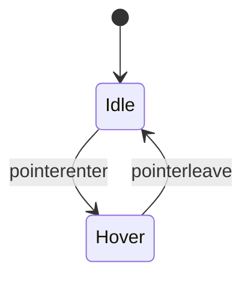

# Interaction Spec: <Widget or area>
Components: K-.. | Controls: C-...

## State machine

## Events and transitions
| From | Event | Guard | To | Side effects | Timing |
|---|---|---|---|---|---|

## Pointer behavior
Thresholds (drag start px), cursors, capture, snapping, collision rules.

## Keyboard
| Key | Context | Action | Notes |
|---|---|---|---|

## Focus management
Where focus goes on open, close, error, delete.

## Motion
| Element | Property | Duration | Delay | Easing | Trigger |
|---|---|---|---|---|---|

## Touch and mobile differences
## Reduced motion behavior
