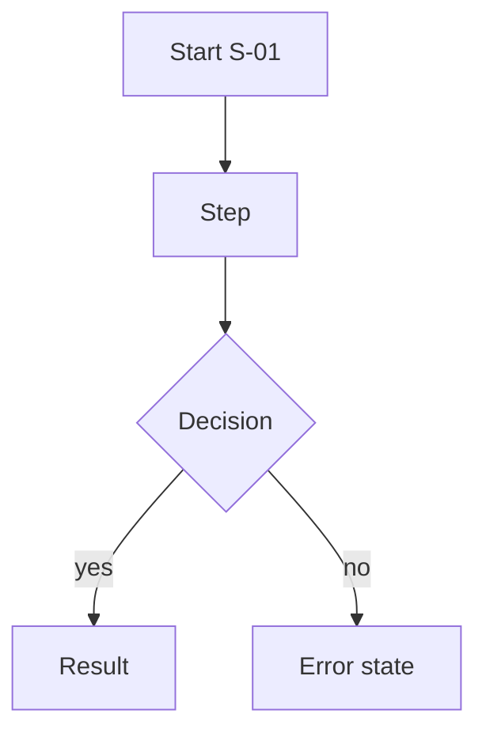

# J-## <Journey name>
Persona: | Goal: | Preconditions: | Success outcome:

## Flow

## Steps
| # | User action | Control (C-###) | Screen/state | System response | Evidence |
|---|---|---|---|---|---|

## Alternate paths
## Error and edge cases
(invalid input, offline, double click, back button, refresh mid flow, permission denied)

## Data created or changed
## Analytics / network calls observed
