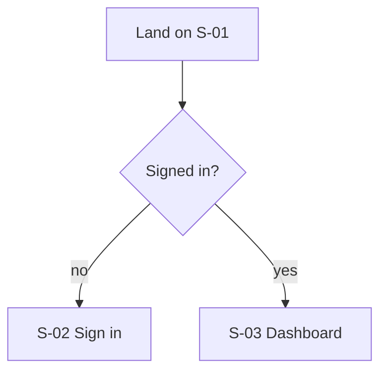
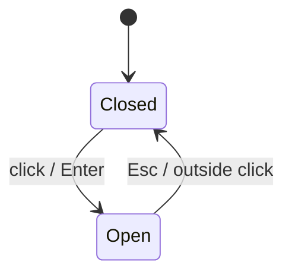

# 07. Document Set and Quality Bar

**Tier gate: this full set is for T1 only (whole product from scratch).** For a feature or an existing codebase write one `IMPLEMENTATION.md` from `assets/templates/implementation-doc.md` and nothing else.

Each document: purpose, required contents, quality bar. Starting files for the main ones are in `assets/templates/`. Write them in `03-docs/` (user flows in `03-docs/user-flows/`, ADRs in `03-docs/adr/`).

Global rules: every claim tagged `[OBSERVED]`, `[INFERRED]`, or `[ASSUMED]`; every spec points to evidence; use IDs (S-## screens, J-## journeys, C-### controls, F-### features, K-## components); measured values, never adjectives.

| # | Document | Purpose | Must contain |
|---|---|---|---|
| 1 | Product Brief | One page grounding | What the product is, who uses it, core value, main journeys, scope of the rebuild, fidelity target |
| 2 | PRD | What to build | Goals, non goals, personas, feature list with IDs and priority, functional requirements per feature, acceptance criteria, edge cases, success metrics, out of scope |
| 3 | TRD | How to build | Stack, architecture overview, rendering approach, data flow, state, performance targets, security, browser support, env, testing strategy, risks |
| 4 | System Architecture | Structure | Component/module diagram (Mermaid), data flow, boundaries, external services, deployment, folder structure |
| 5 | IA and Sitemap | Navigation | Route tree, nav structure, URL patterns, deep link rules, auth gates |
| 6 | User Flows | Journeys | One file per journey: goal, preconditions, Mermaid flowchart, numbered steps with screen and control IDs, alternate paths, errors |
| 7 | Feature Inventory / Matrix | Master list | CSV: id, name, area, description, screens, controls, dependencies, priority, status, card file |
| 8 | Component Inventory / Specs | UI parts | Inventory table plus one spec per component (anatomy, props, variants, states, styles, a11y, responsive) |
| 9 | Design System | Look | Color roles, type scale, spacing, radii, borders, shadows, z-index, breakpoints, motion tokens, icons, grid, light/dark. Machine file `design-tokens.json` |
| 10 | Interaction and Motion Spec | Behavior | State machines per complex widget, timings, easings, gestures, keyboard model, focus management, drag/resize rules, cursor map |
| 11 | Data Model | Entities | Entities, fields, types, relations, constraints, example records, lifecycle, ownership |
| 12 | API Contract | Server surface | Endpoints, methods, auth, request/response schemas, status codes, errors, pagination, rate limits, realtime events, mock fixtures. Mark inferred |
| 13 | State Management Plan | Client state | State inventory (global, local, derived, persisted, server cache), stores, selectors, persistence keys and versions, undo/redo model |
| 14 | Decision Records | Why | One ADR per non-obvious tech choice (template) |
| 15 | Accessibility and Keyboard Map | A11y | Per component roles/labels/keys, focus order, shortcut table with context and conflicts, contrast checks, reduced motion |
| 16 | Content and Copy Deck | Words | Every label, placeholder, tooltip, error, empty state text, toast, with location IDs (paraphrase or replace copyrighted marketing copy; keep UI strings) |
| 17 | Asset Manifest | Files | Every image, icon, font, video, illustration: source, license status, replacement plan, dimensions, format |
| 18 | State Catalog | Edge UI | Every empty, loading, error, offline, permission, success state per screen with trigger and exact UI |
| 19 | Performance Budget | Speed | Load, interaction latency, FPS, memory, bundle limits, how measured, reference baseline |
| 20 | Test Plan and Parity Checklist | Proof | Test matrix (unit, component, e2e, visual, a11y), interaction replay scripts, parity checklist per feature |
| 21 | Build Roadmap | Order | Stages, card order, dependency graph (Mermaid), milestones with demo criteria |
| 22 | Unknowns Log and Risk Register | Honesty | Open questions, assumptions with verification path, risks with mitigation, legal/licensing notes |

## Quality checks before declaring docs done
- A stranger could build from them without opening the reference.
- No adjective-only specs ("clean", "modern"). Every visual spec has numbers.
- Every control from the sweep appears in the Feature Matrix.
- Every screen state appears in the State Catalog.
- Every library choice has a reason and a fallback.
- Unknowns are listed, not hidden.
- Cross references resolve (IDs exist).

## Mermaid conventions
Flow:

State machine:

